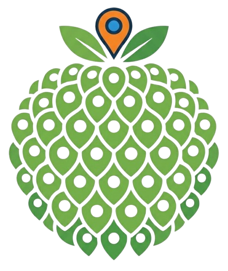

<p align="center">
  
</p>

<h1 align="center">MaPinha</h1>

<p align="center">
  <strong>Um mapa interativo gamificado pra marcar os lugares que importam pra você.</strong>
</p>

<p align="center">
  
  
  
  
  
</p>

---

## O que é

MaPinha é uma aplicação web fullstack que combina navegação geográfica real com uma estética cartunesca e gamificada, inspirada em jogos como GTA e RPGs clássicos. Em vez de um pin genérico do Google Maps, cada **Ponto de Interesse (POI)** pode levar nome, descrição, categoria com ícone próprio, uma imagem, um avatar customizado e um áudio — e pode ser compartilhado publicamente com um link único.

Ferramentas de mapeamento tradicionais são funcionais, mas sem personalidade. O MaPinha é o mapa pessoal de quem quer registrar lugares — a barbearia de confiança, o point dos amigos, o restaurante favorito — com identidade visual própria, trocando de "skin" do mapa (Cartoon, RPG, Urbano, Satélite) em tempo real.

## Screenshots

> _Em breve — capturas de tela e um GIF de demonstração do fluxo principal (criar POI, trocar tema do mapa, calcular rota)._

## Funcionalidades

- 🗺️ **Mapa interativo** (Leaflet) com 4 temas visuais trocáveis em tempo real: Cartoon, RPG, Urbano e Satélite
- 📍 **CRUD completo de POIs** com upload de imagem, avatar e áudio (armazenados no Cloudflare R2 via presigned URL — o binário nunca passa pelo backend)
- 🏷️ **Categorização visual** com 6 categorias (Alimentação, Comércio, Saúde, Lazer, Entretenimento, Residencial), cada uma com ícone e cor próprios
- 🔎 Busca de POIs por nome/categoria e clustering automático por zoom
- ⭐ **Favoritos** e histórico de rotas calculadas
- 🧭 **Cálculo de rotas** via OSRM (distância, tempo estimado) com modo de navegação em tempo real (`watchPosition`) e deep-link para abrir a rota direto no Google Maps
- 🔗 **Compartilhamento público de POIs**: cada POI público gera uma página própria com SSR e metadados Open Graph/Twitter Card (preview bonito ao colar o link no WhatsApp/Twitter)
- 👤 **Perfil do usuário** com estatísticas (POIs cadastrados, km mapeados)
- 🔐 **Login com Google** (NextAuth.js / Auth.js v5)
- 🤖 **3 agentes de IA (Claude)**: categorização automática de POI por descrição, geração de bio/descrição rica, e recomendação de POIs próximos
- 🎬 **Animações** (Framer Motion) em transições de página, entrada de cards e loading states
- 📱 **PWA instalável**, com cache offline dos tiles do mapa via service worker
- 🎓 Onboarding interativo de 3 passos no primeiro acesso
- 🐞 **Monitoramento de erros** com Sentry (frontend e backend)
- ✅ Testes end-to-end (Playwright) cobrindo os fluxos principais

## Stack Técnica

| Camada | Tecnologia |
|---|---|
| Frontend | Next.js 16 (App Router, Turbopack) + TypeScript + Tailwind CSS 4 |
| Mapa | Leaflet + react-leaflet + clustering |
| Estado / dados | Zustand + TanStack Query |
| Autenticação | NextAuth.js (Auth.js v5) com Google OAuth |
| Backend | FastAPI (Python 3.12) |
| Banco de dados | PostgreSQL 16 + PostGIS (geometria/índices espaciais dos POIs) |
| Cache | Redis (clusters de POI por tile, cache de resposta da IA, rate limiting) |
| Storage de mídia | Cloudflare R2 (upload direto via presigned URL) |
| Rotas | OSRM (cálculo de direção, gratuito) |
| IA | Claude API (Anthropic) |
| Monitoramento de erros | Sentry |
| Testes E2E | Playwright |
| Infra local | Docker Compose (Postgres + Redis + backend) |

> Detalhes e justificativas de cada escolha em [docs/02_TECH_STACK.md](docs/02_TECH_STACK.md).

## Arquitetura

O frontend Next.js renderiza o mapa no cliente e se comunica com o backend FastAPI via REST. Rotas client-side passam por um BFF (API routes do Next.js) que injeta um segredo compartilhado (`INTERNAL_API_SECRET`) nas chamadas de escrita; páginas server-side (como a página pública de POI) chamam o backend diretamente. Upload de mídia vai direto do navegador pro Cloudflare R2 via presigned URL gerada pelo backend — nenhum binário trafega pelo servidor de aplicação. O PostgreSQL com PostGIS guarda a geometria dos POIs com índice espacial para buscas por raio/bounding box; o Redis cacheia esses resultados por tile geográfico e também as respostas dos agentes de IA.

Mais detalhes em [docs/01_ARCHITECTURE.md](docs/01_ARCHITECTURE.md).

## Estrutura do projeto

```
mappin-mapa-gamificado-poi/
├── frontend/           # Next.js 16 (App Router)
│   ├── src/app/         # Rotas, API routes (BFF), layout
│   ├── src/components/  # Mapa, POIs, layout, UI
│   ├── src/lib/         # Clientes de API, temas do mapa, deep-links
│   ├── src/stores/      # Zustand
│   └── e2e/             # Testes Playwright
├── backend/            # FastAPI (Python 3.12)
│   ├── app/api/v1/      # Routers (pois, categories, auth, media, routes, ai, users, favorites)
│   ├── app/models/      # SQLAlchemy + PostGIS
│   ├── app/services/    # Agentes de IA, storage R2
│   └── alembic/         # Migrações
├── docs/                # Planejamento e documentação técnica
├── docker-compose.yml   # Postgres + Redis + backend
├── SPRINTS.md           # Histórico detalhado de desenvolvimento, sprint a sprint
└── CLAUDE.md
```

## Rodando localmente

### Pré-requisitos

- [Docker](https://www.docker.com/) + Docker Compose
- Node.js 20+
- Contas gratuitas: Google Cloud (OAuth), Cloudflare (R2), Anthropic (API da IA) — e opcionalmente Sentry

### 1. Clone e configure as variáveis de ambiente

```bash
git clone <url-do-repo>
cd mappin-mapa-gamificado-poi

cp backend/.env.example backend/.env
cp frontend/.env.local.example frontend/.env.local
```

Preencha os dois arquivos:

**`backend/.env`**
| Variável | De onde vem |
|---|---|
| `R2_ACCOUNT_ID` / `R2_ACCESS_KEY_ID` / `R2_SECRET_ACCESS_KEY` / `R2_BUCKET_NAME` / `R2_PUBLIC_URL` | Cloudflare Dashboard → R2 |
| `ANTHROPIC_API_KEY` | [console.anthropic.com](https://console.anthropic.com) |
| `INTERNAL_API_SECRET` | Gere com `openssl rand -hex 32` — **mesmo valor** no frontend |
| `SENTRY_DSN` | Opcional — sentry.io → projeto → Settings → Client Keys (DSN) |

**`frontend/.env.local`**
| Variável | De onde vem |
|---|---|
| `NEXTAUTH_SECRET` | Gere com `openssl rand -base64 32` |
| `GOOGLE_CLIENT_ID` / `GOOGLE_CLIENT_SECRET` | Google Cloud Console → Credentials → OAuth 2.0 Client ID (redirect URI: `http://localhost:3000/api/auth/callback/google`) |
| `INTERNAL_API_SECRET` | **Mesmo valor** usado no backend |
| `NEXT_PUBLIC_SENTRY_DSN` | Opcional — DSN do projeto frontend no Sentry |

### 2. Suba o banco, o Redis e o backend

```bash
docker compose up -d --build
docker compose exec backend alembic upgrade head
```

Backend disponível em `http://localhost:8000` (documentação interativa em `http://localhost:8000/docs`).

### 3. Suba o frontend

```bash
cd frontend
npm install
npm run dev
```

Acesse `http://localhost:3000`.

## Testes e validação

```bash
cd frontend
npm run type-check   # TypeScript
npm run lint         # ESLint
npm run build        # build de produção
npm run test:e2e     # Playwright — requer backend + frontend rodando
```

## Deploy

A arquitetura foi desenhada para **Vercel (frontend) + Railway (backend, Postgres, Redis)**. O deploy automático está pausado por decisão própria (free trial da Railway encerrado — ver `SPRINTS.md`), então no momento o projeto roda via Docker Compose local. Toda a aplicação funciona de ponta a ponta localmente seguindo o passo a passo acima.

## Status do desenvolvimento

O projeto é construído em sprints documentados em detalhe no [SPRINTS.md](SPRINTS.md) — decisões técnicas, bugs encontrados e como foram resolvidos, root causes investigadas, tudo registrado cronologicamente. Visão geral do roadmap em [docs/04_TIMELINE.md](docs/04_TIMELINE.md).

| Sprint | Escopo | Status |
|---|---|---|
| 1 | Setup, design system, infraestrutura base | ✅ Concluído |
| 2 | Mapa interativo e temas visuais | ✅ Concluído |
| 3 | CRUD de POIs e upload de mídia | ✅ Concluído |
| 4 | Sistema de rotas e integração Google Maps | ✅ Concluído |
| 5 | Agentes de IA | ✅ Concluído |
| 6 | Compartilhamento, polimento visual, PWA, testes E2E, Sentry | 🔄 Em andamento |

## Documentação completa

| Documento | Descrição |
|---|---|
| [docs/00_OVERVIEW.md](docs/00_OVERVIEW.md) | Visão geral, problema e público-alvo |
| [docs/01_ARCHITECTURE.md](docs/01_ARCHITECTURE.md) | Arquitetura técnica |
| [docs/02_TECH_STACK.md](docs/02_TECH_STACK.md) | Stack e justificativas |
| [docs/03_AI_AGENTS.md](docs/03_AI_AGENTS.md) | Prompts e design dos agentes de IA |
| [docs/04_TIMELINE.md](docs/04_TIMELINE.md) | Cronograma por fase |
| [docs/05_COST_ANALYSIS.md](docs/05_COST_ANALYSIS.md) | Análise de custos operacionais |
| [SPRINTS.md](SPRINTS.md) | Histórico detalhado de desenvolvimento |
