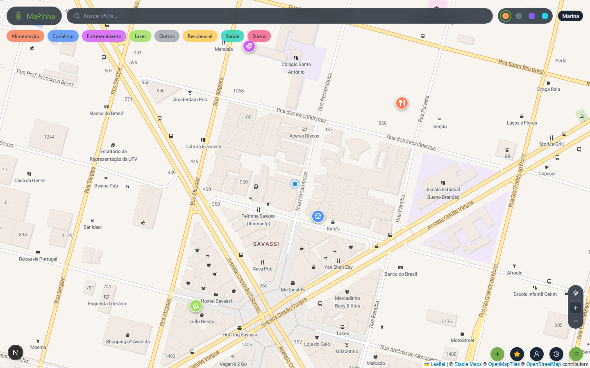
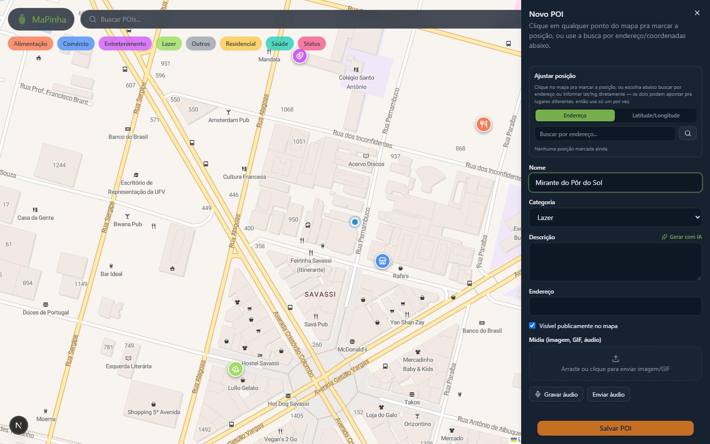
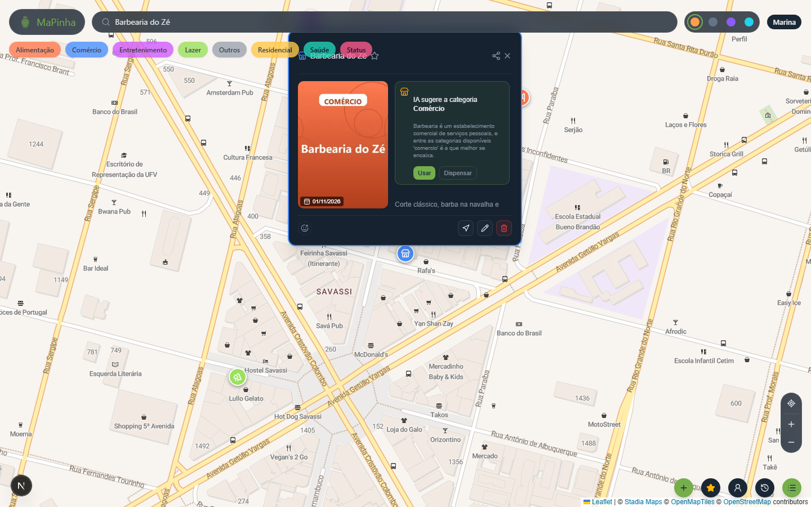
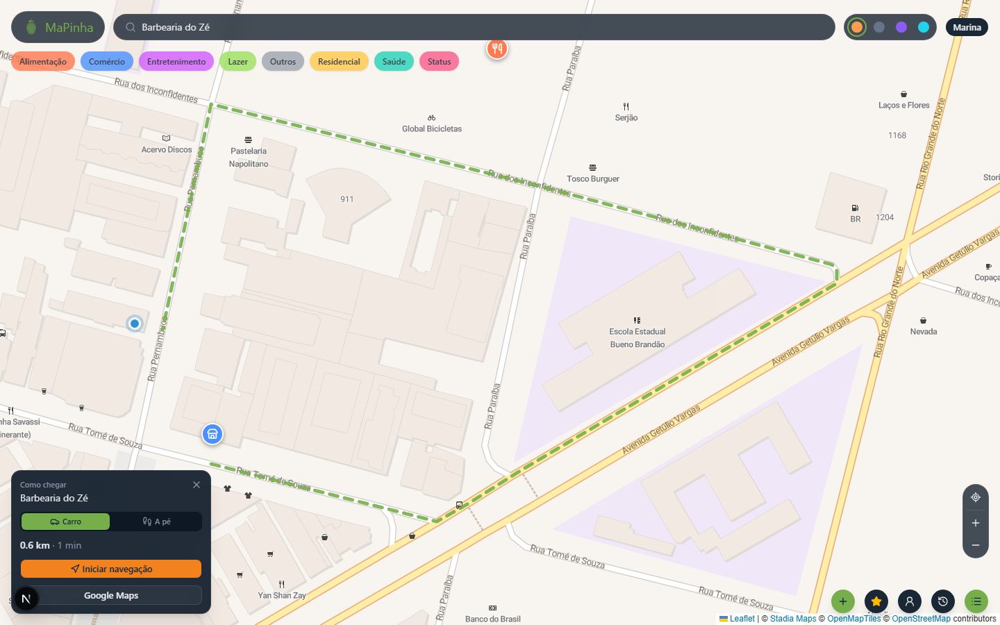
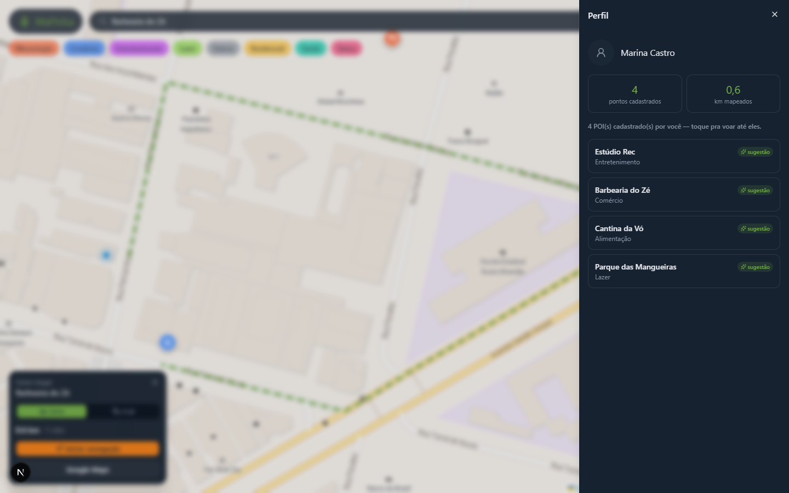
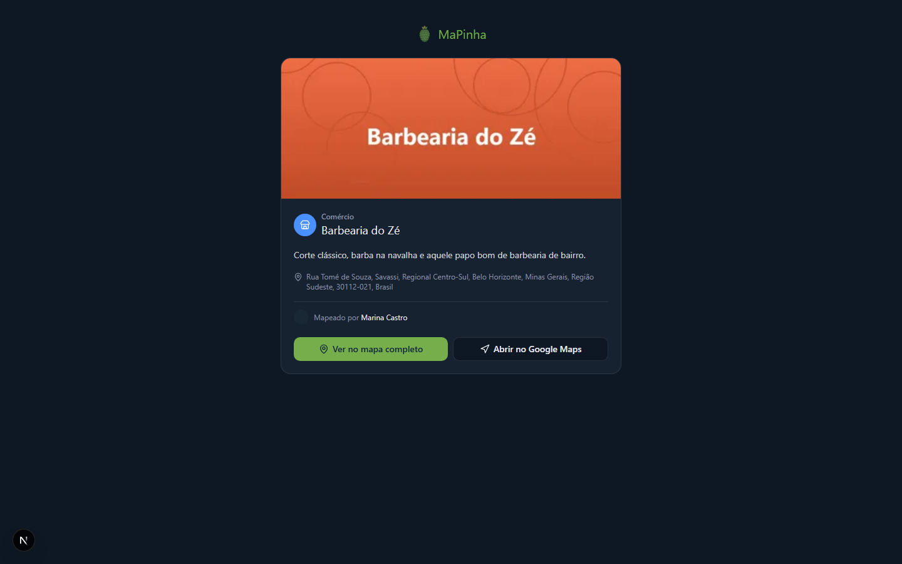
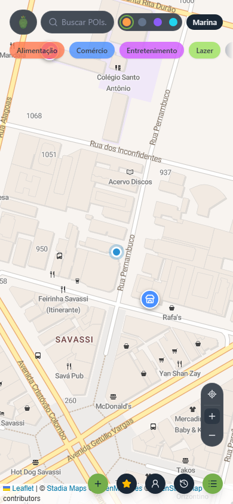

# MaPinha

**Mapa interativo gamificado para marcar e compartilhar os lugares que importam para você.**

## Sobre o projeto

Ferramentas de mapeamento tradicionais são funcionais, mas genéricas: um pin do Google Maps não diz nada sobre quem marcou aquele lugar, nem por quê. O MaPinha resolve isso permitindo cadastrar Marcadores (pontos de interesse) pessoais — a barbearia de confiança, o restaurante favorito, aquele lugar secreto só seu — com nome, descrição, categoria, imagem e áudio, exibidos num mapa com identidade visual própria (quatro temas: Cartoon, RPG, Urbano e Satélite).

É voltado para quem quer um mapa pessoal com personalidade, em vez de um mapa genérico de navegação. Qualquer Marcador pode ser tornado público e compartilhado por link, com uma página própria otimizada para redes sociais.

O projeto está em produção, com deploy completo (frontend, backend, banco de dados e cache, todos em serviços gratuitos):

- Aplicação: https://mapinha-iota.vercel.app
- API: https://mapinha-backend.onrender.com/docs

O desenvolvimento é feito em sprints, documentado em detalhe em [SPRINTS.md](SPRINTS.md) — decisões técnicas, bugs encontrados e como foram resolvidos, tudo registrado cronologicamente. Status atual: Sprint 6 de 6 em andamento (compartilhamento, PWA, monitoramento de erros e deploy já concluídos).

## Prévia

| **Mapa principal** | **Cadastro de Marcador com sugestão de categoria por IA** |
|---|---|
|  |  |

| **Detalhe do Marcador** | **Cálculo de rota** |
|---|---|
|  |  |

| **Perfil e estatísticas** | **Página pública de compartilhamento** |
|---|---|
|  |  |

| **Versão mobile** | |
|---|---|
|  | |

## Funcionalidades

**Mapa**
- Mapa interativo (Leaflet) com quatro temas visuais trocáveis em tempo real: Cartoon, RPG, Urbano e Satélite
- Busca de Marcadores por nome ou categoria, com clustering automático por zoom
- PWA instalável, com cache offline dos tiles do mapa via service worker

**Pontos de interesse**
- CRUD completo de Marcadores, com upload de imagem, avatar e áudio direto para o Cloudflare R2 (o binário nunca passa pelo servidor de aplicação)
- Seis categorias com ícone e cor próprios (Alimentação, Comércio, Saúde, Lazer, Entretenimento, Residencial)
- Reações e favoritos

**Rotas e navegação**
- Cálculo de rotas via OSRM, com distância e tempo estimado
- Modo de navegação em tempo real (geolocalização contínua)
- Deep-link para abrir a rota direto no Google Maps

**Compartilhamento e conta**
- Compartilhamento público de Marcadores: cada um gera uma página própria, renderizada no servidor, com metadados Open Graph e Twitter Card
- Login com Google (NextAuth.js / Auth.js v5)
- Perfil com estatísticas de uso (Marcadores cadastrados, quilômetros mapeados)
- Onboarding interativo de três passos no primeiro acesso

**Inteligência artificial**
- Dois agentes baseados na API da Claude: categorização automática do Marcador a partir da descrição, e geração de bio/descrição

**Infraestrutura**
- Monitoramento de erros (Sentry) no frontend e no backend
- Testes end-to-end (Playwright) cobrindo os fluxos principais
- Deploy automático a cada push, com CI de lint e type-check

## Arquitetura e stack

| Camada | Tecnologia |
|---|---|
| Frontend | Next.js 16 (App Router, Turbopack), TypeScript, Tailwind CSS 4 |
| Mapa | Leaflet, react-leaflet, clustering |
| Estado e dados | Zustand, TanStack Query |
| Autenticação | NextAuth.js (Auth.js v5) com Google OAuth |
| Backend | FastAPI (Python 3.12) |
| Banco de dados | PostgreSQL 16 com PostGIS |
| Cache | Redis |
| Armazenamento de mídia | Cloudflare R2 |
| Cálculo de rotas | OSRM |
| Inteligência artificial | API da Claude (Anthropic) |
| Monitoramento de erros | Sentry |
| Testes end-to-end | Playwright |

O frontend renderiza o mapa no cliente e se comunica com o backend via REST, atrás de um BFF (as próprias rotas de API do Next.js) que injeta um segredo compartilhado nas chamadas que alteram dados. O upload de mídia vai direto do navegador para o Cloudflare R2 por meio de uma URL assinada gerada pelo backend. Quando um Marcador é criado, o backend salva sua geometria no PostgreSQL (com índice espacial via PostGIS) e, em segundo plano, aciona o agente de categorização da Claude, que sugere uma categoria com base no nome e na descrição — sugestão que o usuário pode aceitar ou dispensar diretamente no card do Marcador. O Redis cacheia as consultas de Marcadores por área do mapa e as respostas dos agentes de IA, para reduzir custo e latência.

Mais detalhes em [docs/01_ARCHITECTURE.md](docs/01_ARCHITECTURE.md) e [docs/02_TECH_STACK.md](docs/02_TECH_STACK.md).

## Estrutura do projeto

```
mappin-mapa-gamificado-poi/
├── frontend/              Next.js 16 (App Router)
│   ├── src/app/             rotas, API routes (BFF), layout
│   ├── src/components/      mapa, Marcadores, layout, UI
│   ├── src/lib/              clientes de API, temas do mapa, deep-links
│   ├── src/stores/           estado global (Zustand)
│   └── e2e/                  testes end-to-end (Playwright)
├── backend/               FastAPI (Python 3.12)
│   ├── app/api/v1/           rotas (Marcadores, categorias, auth, mídia, rotas, IA, usuários, favoritos)
│   ├── app/models/           modelos SQLAlchemy + PostGIS
│   ├── app/services/         agentes de IA, integração com o R2
│   └── alembic/              migrações do banco
├── docs/                   planejamento e documentação técnica
├── docker-compose.yml      Postgres + Redis + backend, para desenvolvimento local
└── SPRINTS.md              histórico de desenvolvimento, sprint a sprint
```

## Como rodar localmente

Pré-requisitos: Docker com Docker Compose, Node.js 20 ou superior, e contas gratuitas no Google Cloud (OAuth), Cloudflare (R2) e Anthropic (API de IA).

```bash
git clone <url-do-repositorio>
cd mappin-mapa-gamificado-poi

cp backend/.env.example backend/.env
cp frontend/.env.local.example frontend/.env.local
# preencha as duas variáveis de ambiente com suas credenciais

docker compose up -d --build
docker compose exec backend alembic upgrade head

cd frontend
npm install
npm run dev
```

| Serviço | URL local | Descrição |
|---|---|---|
| Frontend | http://localhost:3000 | Aplicação Next.js |
| Backend | http://localhost:8000 | API FastAPI |
| Documentação da API | http://localhost:8000/docs | Swagger interativo |
| PostgreSQL | localhost:5433 | Banco de dados (porta 5433 no host) |
| Redis | localhost:6379 | Cache |

Validação do frontend: `npm run type-check`, `npm run lint`, `npm run build` e `npm run test:e2e` (este último requer o backend e o frontend em execução).

---

Histórico completo de desenvolvimento, decisões técnicas e bugs resolvidos em [SPRINTS.md](SPRINTS.md).
